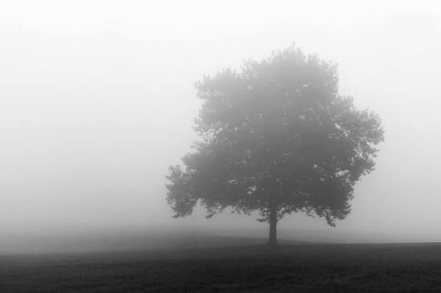
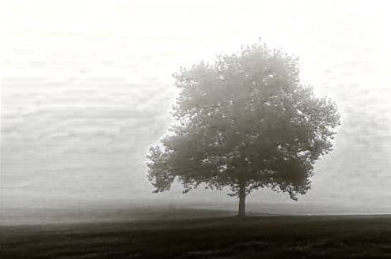
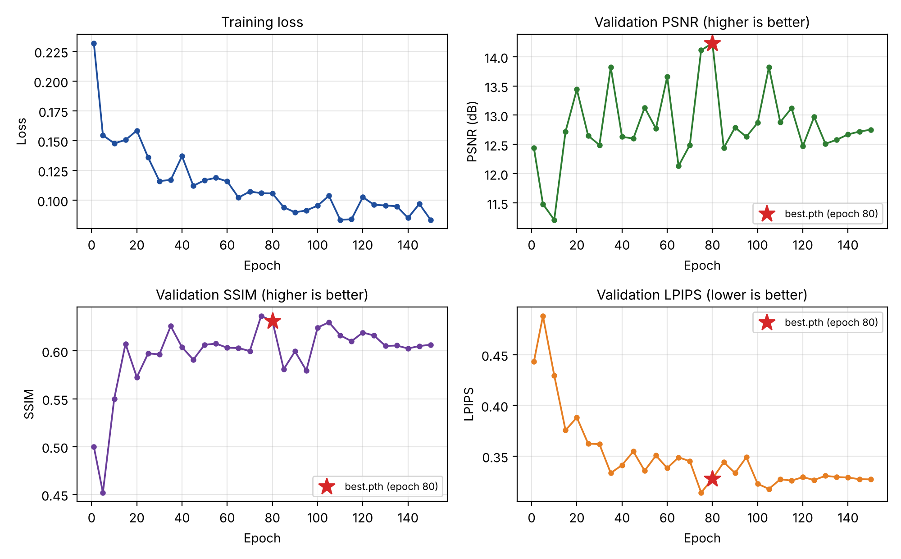

# Noise and Fog Removal from Single Images using Restormer

Single-image fog and noise removal with **Restormer**, fine-tuned on **NH-HAZE** using a Charbonnier + frequency-domain (FFT) loss. The project includes a physics-based synthetic fog generator and a Flask + React web app with a before/after comparison slider.

> EE5340 Course Project (2026) · Faculty Advisor: Prof. Prithwijit Guha

| Foggy input | Restored output |
|:---:|:---:|
|  |  |

---

## Table of Contents
- [Motivation](#motivation)
- [Method](#method)
- [Dataset](#dataset)
- [Training Setup](#training-setup)
- [Results](#results)
- [Web Application](#web-application)
- [Getting Started](#getting-started)
- [Limitations](#limitations)
- [Future Work](#future-work)
- [References](#references)
- [Team](#team)

---

## Motivation

Fog and haze scatter light on its way to the camera. Contrast drops, distant objects fade, and sensor noise becomes visible once contrast is restored. Most vision systems are trained on clear images, so their accuracy falls in fog. Recovering a clear image from a single foggy photo helps in:

- Autonomous driving and driver assistance
- Surveillance and security
- Aerial and satellite imaging
- Maritime and railway monitoring
- Photography enhancement

**Problem:** given a single foggy, noisy RGB image `I`, estimate the clear image `J`, with no depth map or extra views. The problem is ill-posed because fog density, atmospheric light and scene depth are all unknown.

---

## Method

### Pipeline

```
Foggy image → Normalise (0–1) + pad to multiple of 8 → Restormer → Add residual, clip, crop → Restored image
```

The network predicts a **residual** that is added to the input, so it only learns what to remove.

### Atmospheric scattering model

```
I(x) = J(x) · t(x) + A · (1 − t(x)),     t(x) = e^(−β · d(x))
```

where `A` is atmospheric light, `t` is transmission, `β` is fog density and `d` is scene depth. Classical methods estimate `A` and `t` and invert the model; our network learns the mapping `I → J` directly from data.

### Architecture: Restormer

A hierarchical Transformer encoder–decoder with skip connections. Each block has:

- **MDTA (Multi-Dconv Head Transposed Attention):** attention across channels instead of pixels, so the cost is linear in image size.
- **GDFN (Gated-Dconv Feed-Forward Network):** a GELU-gated feed-forward layer that controls which features pass forward.

| Setting | Value |
|---|---|
| Base width | 48 |
| Blocks per level | 4, 6, 6, 8 |
| Refinement blocks | 4 |
| Attention heads | 1, 2, 4, 8 |
| Parameters | 26.1 M |

### Transfer learning

The model is initialised from public Restormer weights pretrained for **real image denoising**, then all layers are fine-tuned on foggy/clear pairs.

### Loss function

```
L_total = L_Char + λ · L_FFT,   λ = 0.1

L_Char = mean( sqrt( (Ĵ − J)² + ε² ) ),   ε = 1e-3
L_FFT  = mean | F(Ĵ) − F(J) |
```

The Charbonnier loss is a smooth, outlier-robust L1; the FFT loss protects edges and fine detail.

### Synthetic fog generator

Fog can be synthesised from clear images using the scattering model: a pseudo-depth map growing towards the horizon with smooth random variation, `β ∈ [0.8, 2.8]`, `A ∈ [0.7, 1.0]`, and Gaussian noise with `σ ≤ 0.02`.
*Implemented, but switched off for the final reported run.*

---

## Dataset

| Dataset | Type | Images | Use |
|---|---|---|---|
| [NH-HAZE](https://data.vision.ee.ethz.ch/cvl/ntire20/nh-haze/) (NTIRE 2020) | Real, non-homogeneous haze | 55 outdoor pairs | 53 train / 2 validation (seed 42) |

No separate test set was used.

---

## Training Setup

| Item | Setting |
|---|---|
| Framework | PyTorch, mixed precision (fp16) |
| Hardware | Google Colab, NVIDIA Tesla T4 |
| Patch / batch size | 128 × 128 / 4, random horizontal and vertical flips |
| Epochs | 150 (~12 s/epoch, ~30 min total) |
| Optimiser | AdamW, LR 2e-4 with cosine decay to 1e-6 |
| Gradient clipping | 1.0 |
| Validation | Every 5 epochs on 384 × 384 centre crops; best PSNR saved as `best.pth` |

---

## Results

Validation scores on the 2 held-out NH-HAZE pairs:

| Checkpoint | PSNR (dB) ↑ | SSIM ↑ | LPIPS ↓ |
|---|---|---|---|
| Epoch 1 (start of fine-tuning) | 12.44 | 0.4998 | 0.4431 |
| **Epoch 80 (best, `best.pth`)** | **14.23** | **0.6312** | **0.3276** |
| Epoch 150 (final) | 12.75 | 0.6064 | 0.3271 |



**Observations**
- Training loss fell steadily from 0.232 to 0.083.
- SSIM improved from 0.50 to about 0.60–0.63; LPIPS fell from 0.443 to about 0.33.
- PSNR fluctuated between 11.2 and 14.2 dB with no clear upward trend; the epoch-80 peak is one favourable point in a noisy measurement.

> These results are a working proof of concept, not a benchmark result. The validation set has only 2 images and was also used for checkpoint selection, so the scores are optimistic.

---

## Web Application

- **Backend:** Flask. Loads `best.pth` on the GPU, receives an uploaded image and returns the restored PNG.
- **Frontend:** React. Drag-and-drop upload, loading indicator, before/after comparison slider and download button.
- Large images are resized to at most 1024 px on the long side to fit in GPU memory.

<!-- Add a screenshot:  -->

---

## Getting Started

> Update the commands below to match the repository's file names.

```bash
# Clone
git clone <repo-url>
cd <repo-name>

# Install dependencies
pip install -r requirements.txt

# Download NH-HAZE and pretrained Restormer real-denoising weights,
# then train
python train.py

# Run inference on a single image
python inference.py --input foggy.jpg --weights best.pth --output restored.png

# Start the web app
python app.py              # Flask backend
cd frontend && npm install && npm start   # React frontend
```

---

## Limitations

- **Artefacts** in smooth regions such as the sky (faint blocky and streaky patterns).
- **Colour tint:** neutral grey inputs can come out slightly warm.
- **Fog reduced, not removed:** distant background can still look hazy.
- **Generalisation gap:** trained on only 53 images; real photos can differ greatly from NH-HAZE scenes.
- **No baseline comparison** with Dark Channel Prior or other networks yet.

---

## Future Work

1. Train on a larger dataset such as RESIDE, together with the synthetic fog generator.
2. Use a larger validation set and a separate test set.
3. Compare against Dark Channel Prior, pretrained Restormer without fine-tuning, DehazeFormer and NAFNet.
4. Reduce artefacts and colour tint with a colour-consistency loss, stronger regularisation or early stopping.
5. Speed up inference with fp16, `torch.compile` and TensorRT; tile large images instead of downscaling.
6. Host the web app on a permanent server.

---

## References

1. S. G. Narasimhan and S. K. Nayar, "Vision and the atmosphere," IJCV, 2002.
2. K. He, J. Sun and X. Tang, "Single image haze removal using dark channel prior," CVPR, 2009.
3. S. W. Zamir et al., "Restormer: Efficient transformer for high-resolution image restoration," CVPR, 2022.
4. Y. Song, Z. He, H. Qian and X. Du, "Vision transformers for single image dehazing," IEEE TIP, 2023.
5. L. Chen, X. Chu, X. Zhang and J. Sun, "Simple baselines for image restoration," ECCV, 2022.
6. C. O. Ancuti, C. Ancuti and R. Timofte, "NH-HAZE: An image dehazing benchmark with non-homogeneous hazy and haze-free images," CVPR Workshops, 2020.
7. Z. Wang et al., "Image quality assessment: From error visibility to structural similarity," IEEE TIP, 2004.
8. R. Zhang et al., "The unreasonable effectiveness of deep features as a perceptual metric," CVPR, 2018.

---

## Team

- Ingale Anup Arjun — 264152004
- Shubham Koli — 264152014
- Sejal Patel — 264152028

**Links:** [Presentation](<link>) · [Video demo](<link>)

## Acknowledgements

Restormer architecture and pretrained weights from [swz30/Restormer](https://github.com/swz30/Restormer).
