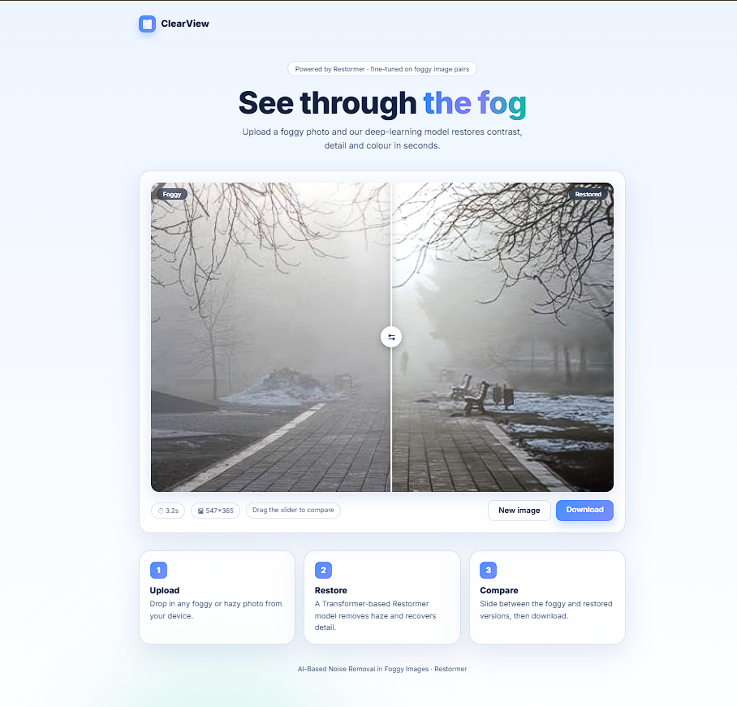

# Noise and Fog Removal from Single Images using Restormer

Single-image fog and noise removal with **Restormer**, fine-tuned on **NH-HAZE** using a Charbonnier + frequency-domain (FFT) loss. The project includes a physics-based synthetic fog generator and **[ClearView](https://anupingale27.github.io/image-dehazing/)**, a web app that runs the model directly in the browser, with a before/after comparison slider.

> EE5340 Course Project (2026) · Faculty Advisor: Prof. Prithwijit Guha

| Foggy input | Restored output |
|:---:|:---:|
|  |  |

## 🔗 Quick Links

| | |
|---|---|
| 🌐 **Live web app (ClearView)** | **[https://anupingale27.github.io/image-dehazing/](https://anupingale27.github.io/image-dehazing/)** |
| 🎬 **Demo video** | [Watch on YouTube](https://youtu.be/eCUuU1nkbP8) |
| 🎤 **Presentation video** | [PASTE YouTube link] |
| 📄 **Report** | [report/Fog_Removal_Project_Report.pdf](report/Fog_Removal_Project_Report.pdf) |
| 📊 **Slides** | [presentation/Fog_Removal_Restormer.pptx](presentation/Fog_Removal_Restormer.pptx) |
| 📓 **Notebook** | [Image_Dehazing.ipynb](Image_Dehazing.ipynb) |
| 🧠 **Trained model** | [ONNX on Hugging Face](https://huggingface.co/anupingale1/clearview-model) · `best.pth`: [GitHub Release v1.0](https://github.com/AnupIngale27/image-dehazing/releases/tag/v1.0) |

---

## Table of Contents
- [Motivation](#motivation)
- [Method](#method)
- [Dataset](#dataset)
- [Training Setup](#training-setup)
- [Results](#results)
- [Web Application](#web-application)
- [Getting Started](#getting-started)
- [Repository Structure](#repository-structure)
- [Limitations](#limitations)
- [Future Work](#future-work)
- [References](#references)
- [Team](#team)

---

## Motivation

Fog and haze scatter light on its way to the camera. Contrast drops, distant objects fade, and sensor noise becomes visible once contrast is restored. Most vision systems are trained on clear images, so their accuracy falls in fog. Recovering a clear image from a single foggy photo helps in:

- Autonomous driving and driver assistance
- Surveillance and security
- Aerial and satellite imaging
- Maritime and railway monitoring
- Photography enhancement

**Problem:** given a single foggy, noisy RGB image `I`, estimate the clear image `J`, with no depth map or extra views. The problem is ill-posed because fog density, atmospheric light and scene depth are all unknown.

---

## Method

### Pipeline

```
Foggy image → Normalise (0–1) + pad to multiple of 8 → Restormer → Add residual, clip, crop → Restored image
```

The network predicts a **residual** that is added to the input, so it only learns what to remove.

### Atmospheric scattering model

```
I(x) = J(x) · t(x) + A · (1 − t(x)),     t(x) = e^(−β · d(x))
```

where `A` is atmospheric light, `t` is transmission, `β` is fog density and `d` is scene depth. Classical methods estimate `A` and `t` and invert the model; our network learns the mapping `I → J` directly from data.

### Architecture: Restormer

A hierarchical Transformer encoder–decoder with skip connections. Each block has:

- **MDTA (Multi-Dconv Head Transposed Attention):** attention across channels instead of pixels, so the cost is linear in image size.
- **GDFN (Gated-Dconv Feed-Forward Network):** a GELU-gated feed-forward layer that controls which features pass forward.

| Setting | Value |
|---|---|
| Base width | 48 |
| Blocks per level | 4, 6, 6, 8 |
| Refinement blocks | 4 |
| Attention heads | 1, 2, 4, 8 |
| Parameters | 26.1 M |

### Transfer learning

The model is initialised from public Restormer weights pretrained for **real image denoising**, then all layers are fine-tuned on foggy/clear pairs.

### Loss function

```
L_total = L_Char + λ · L_FFT,   λ = 0.1

L_Char = mean( sqrt( (Ĵ − J)² + ε² ) ),   ε = 1e-3
L_FFT  = mean | F(Ĵ) − F(J) |
```

The Charbonnier loss is a smooth, outlier-robust L1; the FFT loss protects edges and fine detail.

### Synthetic fog generator

Fog can be synthesised from clear images using the scattering model: a pseudo-depth map growing towards the horizon with smooth random variation, `β ∈ [0.8, 2.8]`, `A ∈ [0.7, 1.0]`, and Gaussian noise with `σ ≤ 0.02`.
*Implemented, but switched off for the final reported run (set `SYNTHETIC = True` in the notebook to use it).*

---

## Dataset

| Dataset | Type | Images | Use |
|---|---|---|---|
| [NH-HAZE](https://data.vision.ee.ethz.ch/cvl/ntire20/nh-haze/) (NTIRE 2020) | Real, non-homogeneous haze | 55 outdoor pairs | 53 train / 2 validation (seed 42) |

No separate test set was used.
The dataset is **not stored in this repository**. The notebook downloads it automatically.

---

## Training Setup

| Item | Setting |
|---|---|
| Framework | PyTorch, mixed precision (fp16) |
| Hardware | Google Colab, NVIDIA Tesla T4 |
| Patch / batch size | 128 × 128 / 4, random horizontal and vertical flips |
| Epochs | 150 (~12 s/epoch, ~30 min total) |
| Optimiser | AdamW, LR 2e-4 with cosine decay to 1e-6 |
| Gradient clipping | 1.0 |
| Validation | Every 5 epochs on 384 × 384 centre crops; best PSNR saved as `best.pth` |

---

## Results

Validation scores on the 2 held-out NH-HAZE pairs:

| Checkpoint | PSNR (dB) ↑ | SSIM ↑ | LPIPS ↓ |
|---|---|---|---|
| Epoch 1 (start of fine-tuning) | 12.44 | 0.4998 | 0.4431 |
| **Epoch 80 (best, `best.pth`)** | **14.23** | **0.6312** | **0.3276** |
| Epoch 150 (final) | 12.75 | 0.6064 | 0.3271 |


**Real foggy photo (not from NH-HAZE):**


**Observations**
- Training loss fell steadily from 0.232 to 0.083.
- SSIM improved from 0.50 to about 0.60–0.63; LPIPS fell from 0.443 to about 0.33.
- PSNR fluctuated between 11.2 and 14.2 dB with no clear upward trend; the epoch-80 peak is one favourable point in a noisy measurement.

> These results are a working proof of concept, not a benchmark result. The validation set has only 2 images and was also used for checkpoint selection, so the scores are optimistic.

---

## Web Application

**[ClearView](https://anupingale27.github.io/image-dehazing/)** lets anyone upload a foggy photo, compare it with the restored result using a slider, and download it. It runs **entirely in the browser**: no server, and photos never leave the user's device.



**How it works**
- The trained model is exported to **ONNX** (`clearview_512.onnx`, 105 MB) and stored in a free [Hugging Face model repo](https://huggingface.co/anupingale1/clearview-model).
- The page ([`docs/index.html`](docs/index.html), React) is hosted on **GitHub Pages**.
- **ONNX Runtime Web** runs the model in the browser: on the GPU through **WebGPU** (Chrome/Edge), otherwise on the CPU through WebAssembly.
- Images are processed in overlapping 512 × 512 tiles that are blended together, so larger photos work too (up to 1024 px on GPU, 512 px on CPU).

| | Browser |
|---|---|
| First visit | Downloads the 105 MB model once (then cached) |
| Chrome / Edge (WebGPU) | A few seconds per image |
| Other browsers / phones (CPU) | Up to about a minute per image |

The notebook also contains a Flask version (last cells) that runs on the Colab GPU with a temporary public link.

---

## Getting Started

### Option 1: Just try it
Open the **[live web app](https://anupingale27.github.io/image-dehazing/)** in Chrome or Edge and upload a foggy photo.

### Option 2: Run the notebook (training + web app)
1. Open [`Image_Dehazing.ipynb`](Image_Dehazing.ipynb) in [Google Colab](https://colab.research.google.com/).
2. Go to **Runtime → Change runtime type → T4 GPU**.
3. Run the cells in order:

| Cells | What they do |
|---|---|
| 1 | Install packages, clone Restormer |
| 2 | Settings (paths, patch size, epochs, learning rate) |
| 3 | Download NH-HAZE and arrange it into `Foggy/` and `GT/` folders |
| 4 | Pair images, train/validation split, data loaders, synthetic fog |
| 5 | Build Restormer and load pretrained real-denoising weights |
| 6 | Train for 150 epochs; saves `best.pth` and `last.pth` |
| 7 | Test on your own uploaded images |
| 8 | Free GPU memory |
| 9–12 | Web app: write the page, start Flask, open a public link |

**Skip training (~30 min):** download `best.pth` from the [Release](https://github.com/AnupIngale27/image-dehazing/releases/tag/v1.0), upload it to `/content/fog_checkpoints/best.pth` in Colab, run cell 1, then run cells 9–12.

### Option 3: Host your own copy of the web app (free)
1. After training, run the ONNX export cell from [`export_onnx_cell.py`](export_onnx_cell.py) at the end of the notebook. It checks the ONNX output against PyTorch and downloads `clearview_512.onnx`.
2. Create a **public model repo** on [Hugging Face](https://huggingface.co/new) and upload `clearview_512.onnx`.
3. In [`docs/index.html`](docs/index.html), set `MODEL_URL` to `https://huggingface.co/<username>/<repo>/resolve/main/clearview_512.onnx`.
4. In your GitHub repo, go to **Settings → Pages → Deploy from a branch → `main` / `/docs`**.

---

## Repository Structure

```
├── Image_Dehazing.ipynb      # training, testing and Flask web app (Colab)
├── export_onnx_cell.py       # converts best.pth to ONNX for the browser app
├── docs/
│   └── index.html            # ClearView web app (served by GitHub Pages)
├── assets/                   # images used in this README
├── report/                   # project report (PDF, DOCX)
└── presentation/             # slides (PPTX)
```

Not stored in the repo: the NH-HAZE dataset (downloaded by the notebook), the ONNX model ([Hugging Face](https://huggingface.co/anupingale1/clearview-model)), `best.pth` (attached to the [Release](https://github.com/AnupIngale27/image-dehazing/releases/tag/v1.0)), and the videos (on YouTube).

---

## Limitations

- **Artefacts** in smooth regions such as the sky (faint blocky and streaky patterns).
- **Colour tint:** neutral grey inputs can come out slightly warm.
- **Fog reduced, not removed:** distant background can still look hazy.
- **Generalisation gap:** trained on only 53 images; real photos can differ greatly from NH-HAZE scenes.
- **No baseline comparison** with Dark Channel Prior or other networks yet.
- **Browser limits:** without WebGPU the app runs on the CPU (slow, images limited to 512 px); the first visit downloads a 105 MB model.

---

## Future Work

1. Train on a larger dataset such as RESIDE, together with the synthetic fog generator.
2. Use a larger validation set and a separate test set.
3. Compare against Dark Channel Prior, pretrained Restormer without fine-tuning, DehazeFormer and NAFNet.
4. Reduce artefacts and colour tint with a colour-consistency loss, stronger regularisation or early stopping.
5. Speed up inference with fp16, `torch.compile` and TensorRT; tile large images instead of downscaling.
6. Shrink the browser model (fp16 or int8 quantisation) for faster loading and mobile use.

---

## References

1. S. G. Narasimhan and S. K. Nayar, "Vision and the atmosphere," IJCV, 2002.
2. K. He, J. Sun and X. Tang, "Single image haze removal using dark channel prior," CVPR, 2009.
3. S. W. Zamir et al., "Restormer: Efficient transformer for high-resolution image restoration," CVPR, 2022.
4. Y. Song, Z. He, H. Qian and X. Du, "Vision transformers for single image dehazing," IEEE TIP, 2023.
5. L. Chen, X. Chu, X. Zhang and J. Sun, "Simple baselines for image restoration," ECCV, 2022.
6. C. O. Ancuti, C. Ancuti and R. Timofte, "NH-HAZE: An image dehazing benchmark with non-homogeneous hazy and haze-free images," CVPR Workshops, 2020.
7. Z. Wang et al., "Image quality assessment: From error visibility to structural similarity," IEEE TIP, 2004.
8. R. Zhang et al., "The unreasonable effectiveness of deep features as a perceptual metric," CVPR, 2018.

---

## Team

| Name | Roll No. |
|---|---|
| Ingale Anup Arjun | 264152004 |
| Shubham Koli | 264152014 |
| Sejal Patel | 264152028 |

Faculty Advisor: Prof. Prithwijit Guha

## Acknowledgements

Restormer architecture and pretrained weights from [swz30/Restormer](https://github.com/swz30/Restormer). NH-HAZE dataset from the NTIRE 2020 challenge.
